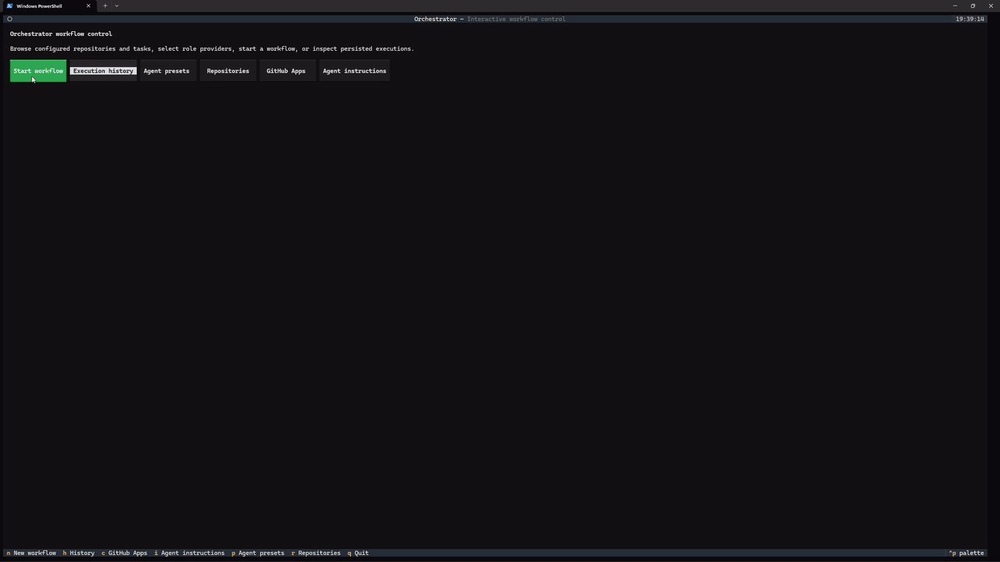

# Autonomous Dev Orchestrator

Autonomous Dev Orchestrator turns a GitHub issue or Trello card into a reviewed pull request. It plans the change, implements it in an isolated Git worktree, runs your validation commands, opens a pull request, and performs an automated review. It never merges: the final decision is always yours.



*Start a workflow, then inspect a completed execution and its detailed logs.*

## Status

This is an early v0.1.0 release, designed for one user running one process.

Known limitations:

- Work runs inside the app's process. Closing the app interrupts active executions; on reopening, you can choose which interrupted executions to resume.
- On macOS, recovery checks retained worktrees for surviving processes and leaves an execution interrupted until its worktree is idle.
- SQLite is the default database, local Qdrant is single-process, and provider concurrency limits don't coordinate across processes.
- Nothing is rolled back after a failure: a pushed branch or open pull request stays in place. Inspect the saved execution and its worktree before continuing.

## Before you run it

Agents act with your authenticated GitHub CLI and local credentials. Start with a repository you can afford to experiment on. Review every pull request before merging: the orchestrator never merges, but agents write the code. With `approve-for-me` or similar unattended modes, agents run commands in the worktree without per-command review. Put credentials in environment variables, never in YAML. Validation commands run on your machine.

## Requirements

- Python 3.11 or newer, and Git.
- The GitHub CLI (`gh`), installed and authenticated for the repository you want to use.
- A CLI backend for the implementer:
  - [Codex CLI](https://github.com/openai/codex) v0.44.0 or newer (tested with v0.160.0). It needs noninteractive `codex exec` with the `--json` event output and `--output-schema`. The optional `approval_policy: approve-for-me` also needs v0.147.0 or newer.
  - [Claude Code](https://docs.claude.com/en/docs/claude-code) v2.1.259 or newer (tested with v2.1.288). The provider always passes `--restricted` (v2.1.248) and `--permission-prompts none` (v2.1.259). The optional `bare_mode` needs v2.1.81 or newer, and `effort: xhigh` needs v2.1.111.
- Optional API models through [LiteLLM](https://docs.litellm.ai/) for planning and review.

## Installation

Install the command in an isolated environment with [pipx](https://pipx.pypa.io/):

```sh
pipx install git+https://github.com/OrlyJunior/autonomous-development-orchestrator
```

Or, from a local clone:

```sh
pipx install .
```

For development, install the package and contributor tools in a virtual environment:

```sh
python -m pip install -e ".[dev]"
```

Create and activate that virtual environment first. Install the target repository's own
dependencies and validation tools separately; the orchestrator's environment does not supply
them to every repository it works on.

## Configuration

The app reads one global `orchestrator.yml`. An explicit `--config` path takes precedence, followed by the `ORCHESTRATOR_CONFIG`, `ORCHESTRATOR_CONFIG_PATH`, and `ORCHESTRATOR_CONFIG_FILE` environment variables. Otherwise it looks in `~/.config/orchestrator/orchestrator.yml`, then `~/.orchestrator/orchestrator.yml`. Repository-local `.orchestrator.yml` files are ignored.

Before the first run, create the parent directory and save your configuration in one of those global locations, or pass `--config` to the command. Installation does not create the YAML file. Start from [orchestrator.example.yml](orchestrator.example.yml) or the minimal example below and replace its repository paths and provider settings.

`--config` belongs after the subcommand, for example
`orchestrator providers --config /absolute/path/to/orchestrator.yml`. Relative `--config`
paths use the current directory; relative `ORCHESTRATOR_CONFIG*` paths use your home directory.

The app loads its settings and Trello credentials from the optional `~/.orchestrator/.env` file. A repository-local `.env` is not loaded; [.env.example](.env.example) shows the format. The three configuration selectors above are read only from the process environment, not from `.env`.

API provider keys such as `OPENAI_API_KEY` must be in the process environment. The
user-global `.env` file supplies the app's `ORCHESTRATOR_*` settings; it does not export
arbitrary provider credentials to subprocesses or LiteLLM. The full YAML example uses
`OPENAI_API_KEY` for its planner and reviewer; the minimal example below uses Codex for all roles.

- `ORCHESTRATOR_DATABASE_URL`: database URL override (default: unset).
- `ORCHESTRATOR_DATABASE_PATH`: alternative SQLite file path (default: unset).
- `ORCHESTRATOR_LOG_LEVEL`: log level (default: `INFO`).

Set only one database override. Without either, the app uses global persistence settings or an existing database beside the global YAML, otherwise SQLite at `~/.orchestrator/orchestrator.db`.

This example uses one Codex provider for all three roles. Replace the repository path, base branch, and validation commands with values for your checkout:

```yaml
defaults:
  repository:
    base_branch: main
  agents:
    planner:
      provider: codex
    implementer:
      provider: codex
    reviewer:
      provider: codex
  providers:
    codex:
      type: codex-cli
      command: [codex, exec, --sandbox, workspace-write, --output-last-message, "{output_file}", -]
      approval_policy: approve-for-me
  integrations:
    github:
      command: [gh]
  validation:
    commands:
      - [python, -m, pytest]

repositories:
  owner/repository:
    path: /absolute/path/to/repository
```

Use the GitHub `owner/repository` of your local clone, choose a base branch that exists on
its remote, and use validation commands that work in that repository's worktree. The
`python -m pytest` command above is a Python example, not a requirement for every project.

For unattended Codex runs, we recommend `approval_policy: approve-for-me` as shown. The adapter passes `--approve-for-me` and removes the explicit `--sandbox` argument; Codex uses the `workspace-write` sandbox for this mode. [Codex Auto-review](https://learn.chatgpt.com/docs/sandboxing/auto-review) handles actions that need approval, while ordinary edits inside the worktree proceed without review. If Auto-review is unavailable for your account, omit `approval_policy` and keep the `--sandbox workspace-write` command.

Each provider runs one agent call at a time by default. To allow more, set `max_concurrency` on the provider under `defaults.providers`.

For the `claude-code` provider, `bare_mode` defaults to `false`. Claude subscription users should leave it off (omit it or set `bare_mode: false`) and authenticate with Claude Code outside the orchestrator.

Claude Code defaults to `permission_mode: dontAsk`. For an implementer that needs to edit
files, select `acceptEdits` for that role through a preset or launch override, or set it on
the provider. The adapter always passes `--permission-prompts none`: actions that would
require a prompt are denied instead of waiting for input. It exposes file tools, not Bash;
the orchestrator runs validation commands separately.

Optionally set `bare_mode: true` for reproducible runs that skip user hooks, plugins, skills, and MCP auto-discovery. [Bare mode requires an API key (`ANTHROPIC_API_KEY`) or supported cloud credentials](https://code.claude.com/docs/en/headless#start-faster-with-bare-mode); it does not use subscription login credentials. The provider always passes [`--restricted`](https://code.claude.com/docs/en/cli-reference#cli-flags), which confines Claude Code's file tools to the supplied worktree with or without bare mode. See [orchestrator.example.yml](orchestrator.example.yml) for provider options.

Credentials belong in environment variables or ambient `gh` authentication, never in YAML. For Trello, set `ORCHESTRATOR_TRELLO_API_KEY` and `ORCHESTRATOR_TRELLO_TOKEN`. Optional GitHub App identities are described in [GitHub App setup](docs/github_app.md).

## First run

Authenticate the selected agent CLI and `gh` before starting the orchestrator. The GitHub
account must be able to read the task and push a branch/open a pull request in the target
repository. Git push authentication must also work for the clone's remote; `gh` authentication
alone does not configure every Git transport. Optional GitHub Apps can supply separate identities.

After saving your YAML, check that it loads and lists the providers you expect:

```sh
orchestrator providers --config /absolute/path/to/orchestrator.yml
```

This checks configuration, not CLI authentication or API access. Then start the terminal UI
using the same file:

```sh
orchestrator tui --config /absolute/path/to/orchestrator.yml
```

On the home screen, choose **Repositories** → **Add repository** → **Save repository** to register a local checkout, if it isn't already in your configuration. For GitHub Issues, use its `owner/repository` key and select an existing open issue. Then choose **Start workflow**, select the repository and task provider, pick a task, and start it. Saved settings remain in the same global YAML file.

The equivalent command for a GitHub issue:

```sh
orchestrator run --github-issue ISSUE_NUMBER --repository owner/repository --config /absolute/path/to/orchestrator.yml
```

For a Trello card, use `orchestrator run --trello-card CARD_ID --repository owner/repository --config /absolute/path/to/orchestrator.yml` after configuring its credentials. A card's `Repository` custom field can identify its configured repository when no explicit override is supplied.

You can omit `--config` when the file is in one of the automatic discovery locations above.

## Providers and presets

A provider is a named connection to an agent. Each role (planner, implementer, reviewer)
chooses a provider by name. A preset is a reusable choice of provider and model, reasoning
effort, permission mode, or generation options for one role.

**API models can plan and review. The implementer needs Codex CLI or Claude Code to edit files.**

Open **Providers** from the home screen (shortcut **o**). **How should this agent run?** offers:

| Choice | YAML `type` | What it calls |
| --- | --- | --- |
| Codex CLI | `codex-cli` | An installed CLI in the supplied worktree. |
| Claude Code | `claude-code` | An installed CLI with restricted file tools in the supplied worktree. |
| Model API (LiteLLM) | `litellm` | An API model that returns text or structured output. |

The screen edits `defaults.providers` in the existing global `orchestrator.yml`; no
repository selection is needed. **Connection** holds the command or executable, endpoint,
API key environment variable name, timeout in seconds, and maximum simultaneous calls.
The collapsed **Defaults when no preset or launch value overrides them** holds model,
reasoning effort, and permission settings where supported. Model API requires a base model
in its provider definition, even when a preset supplies a different model.

The precedence is **launch value > preset > repository provider setting > global provider
setting > backend default**. Repository provider overrides win over this screen's edits.
Concurrency is global: repository overrides cannot set `max_concurrency`. Other YAML options
are preserved when saving the same run method. Changing the run method starts with that
backend's fields. Provider names stay fixed when editing; used providers cannot be removed.
An empty screen suggests a first provider named `codex` using Codex CLI.

For Gemini on Vertex, choose **Model API (LiteLLM)**, then **Use Gemini on Vertex template**.
Complete the `vertex_ai/` model prefix and replace the project placeholder. The template sets
`generation.vertex_project` and `generation.vertex_location` (initially `global`). Authenticate
outside the screen using Application Default Credentials, for example
`gcloud auth application-default login`. For other APIs, `api_key_env` holds the environment
variable's name; set the secret value outside the screen. Without that reference, LiteLLM
uses the selected backend's environment or ambient credentials. CLIs also authenticate
outside the editor.

Existing `gemini-vertex` definitions load as LiteLLM in memory with a warning, preserving
their provider names. Loading does not rewrite YAML. Saving an edited entry writes the
displayed LiteLLM format. See [orchestrator.example.yml](orchestrator.example.yml) for the
Vertex settings and other provider options.

Presets live in `defaults.agent_presets.<role>` or
`repositories.<key>.agent_presets.<role>`. **Agent presets** and explicit preset save actions
on **Start workflow** write repository-scoped presets in the global YAML. Updating a preset
preserves generation keys that the screen does not display. Selecting a preset on Start
workflow copies those options for that run. The role controls show effective model, effort,
and permission values with their source: launch, preset, provider, or default. Unchanged
prefilled values show their inherited source. A manual edit detaches the selected preset;
its copied values become launch values. An omitted CLI model or effort shows **CLI default**
because the exact value depends on the CLI's own settings.

Ordinary launch selections do not edit YAML. The run saves its provider selections and
runtime options for continuation. Saved provider settings apply to subsequent submissions;
active runs retain their resolved settings. Missing local executables produce a warning.
Restart the TUI after changing an existing provider's `max_concurrency`, or to expand the
dispatcher's startup capacity.

## CLI overview

| Command | What it does |
| --- | --- |
| `orchestrator run` | Run one GitHub issue (`--github-issue`), Trello card (`--trello-card`), or configured task provider ID (`--task-id`). |
| `orchestrator tui` | Open the interactive launcher, settings, and execution history. |
| `orchestrator respond EXECUTION_ID --message "..."` | Answer an agent's blocking question and resume that execution. |
| `orchestrator show EXECUTION_ID` | Print a saved execution as JSON. |
| `orchestrator cleanup-workspaces --repository owner/repository` | Remove eligible retained worktrees. Use `--dry-run` to preview. |
| `orchestrator debug --stage STAGE` | Run one diagnostic stage. `--dry-run` previews its inputs without calling integrations. |
| `orchestrator providers` | List configured agent providers. |
| `orchestrator --version` | Print the installed version. |

Run `orchestrator --help` or `orchestrator SUBCOMMAND --help` for the full option list.
`show`, workflow commands, TUI startup, and cleanup initialize persistence and apply pending
database migrations. Cleanup's `--dry-run` prevents worktree deletion; it does not make
database access read-only. `debug --dry-run` avoids integrations, but adding
`--from-execution` still opens persistence and applies migrations.
Cleanup's `--include-failed` (or `--all`) also includes cancelled and human-blocked executions;
active, interrupted, and unmanaged worktrees remain protected.

## Repository context

Agents get relevant code from your repository through Qdrant semantic retrieval, which is the default for registered repositories. The first time it's used, the orchestrator downloads a small local embedding model and builds an index of your repository. This takes some CPU time on large repositories, but only happens once; later runs only process files that changed.

If semantic retrieval is unavailable, a simpler heuristic retrieval is used instead. You can also select it permanently with `repository_context.strategy: heuristic`. Local Qdrant is the default; `repository_context.qdrant.mode: server` connects to a separately running Qdrant server configured with `url` or `host`.

Opening a repository's index management view checks the configured checkout and refreshes a
STALE index in the background. Reopening joins an update already in progress. STALE means the
recorded commit differs from the checkout's current HEAD; it alone does not indicate a run
retrieval failure, because each run indexes its own snapshot. Displayed document and chunk
counts cover the whole checkout index, including unchanged files.

Workflow retrieval and index actions share one local-store lock. A screen action skips promptly
if the store is busy; a workflow arriving during an admitted refresh waits for it to finish.
Busy results retry on the next screen open or manual action. There is no idle polling or watcher;
external checkout changes are checked on the next opening or manual refresh.

## Role guidance files

Optional local `PLANNER.md`, `IMPLEMENTER.md`, and `REVIEWER.md` files in your repository give each role its own extra instructions. Each role sees only its own file. This project's `.gitignore` excludes them; add them to your repository's ignore rules if you want to keep them local. You can edit them from the TUI.

We recommend adding a versioned [docs/PROJECT_CONTEXT.md](docs/PROJECT_CONTEXT.md) to every repository the orchestrator works on. It is shared by the planner, implementer, and reviewer; the orchestrator reads it when present but does not scaffold it. Without it, each run has to rediscover project boundaries and design rules from the task and retrieved code. A brand-new repository can start without it and add it once there is real code to describe.

- Keep it short and durable: purpose and boundaries, layering rules, invariants, design decisions (including things deliberately not done), and where secrets and configuration come from.
- Leave out feature descriptions, UI details, and per-change notes. The code, tests, and repository retrieval already cover those.
- It is supplementary: the task, repository state, and the orchestrator's own invariants remain authoritative.
- The prompt includes at most 12,000 characters of stripped content. Longer content is truncated with a notice and a workflow warning; the file stays intact.
- The implementer is instructed to update it only when a change alters an architecture-level decision, keeping it within the cap by condensing or replacing existing content.

## Safety model

- Implementation happens in an isolated Git worktree. Your main checkout is never switched, reset, or cleaned.
- Agents are instructed never to commit, push, create pull requests, or merge. The orchestrator performs those steps itself, and never merges.
- Commits and pushes to protected branches (`main`, `master`, and `develop` by default) are refused.
- Worktrees are kept for inspection until you clean them up with `cleanup-workspaces`.
- New worktrees default to `~/.orchestrator/workspaces/<repo>/<execution-id>`, using the
  same per-user state directory as the database and the separate `qdrant` folder.
  Set `defaults.workspace.root` or `repositories.<key>.workspace.root` to override the root.
  Existing executions keep their recorded paths. `cleanup-workspaces` also lists and
  manages the previous sibling `orchestrator-workspaces/<repo>/<execution-id>` location;
  its `--dry-run` previews retention decisions. Existing worktrees are never migrated automatically.

## Troubleshooting

- **`GitHub CLI failed`:** check that `gh` is authenticated and has access to the target repository.
- **`Executable not found: codex`, `claude`, or `gh`:** install the CLI and make sure it's on your `PATH`, or select a provider you have installed.
- **Claude Code authentication fails with `bare_mode: true`:** bare mode requires an API key or supported cloud credentials. For a Claude subscription, omit `bare_mode` or set it to `false` and authenticate with Claude Code outside the orchestrator.
- **`Global configuration not found. Searched:`:** put `orchestrator.yml` in one of the locations listed under Configuration, or pass `--config` with an existing file.
- **A local Qdrant index lock error:** another process is using the index. Index management shows
  BUSY without recording a failure. After closing the other process, reopen the view or press
  Refresh changed files to retry. You can also configure Qdrant server mode.

## Contributing

Label pull requests Feature, Improvement or Bug (or skip-changelog for internal changes) so the generated release notes group them correctly.

Install the development dependencies above, then run:

```sh
python -m pytest
python -m ruff check .
python -m mypy src/orchestrator
```

Database schema changes use versioned Alembic migrations in `src/orchestrator/migrations/versions`. From the repository root, create one with `alembic revision --autogenerate -m "describe change"` and apply it with `alembic upgrade head`. CLI commands that open persisted execution state apply pending migrations automatically; `--help`, `--version`, and `providers` do not.

### Releasing

To publish a release, under **Actions → Release**, run the workflow on the `develop` branch and choose the `patch`, `minor`, or `major` increment.

The first release tag is `v0.1.0`. Before later releases, update `project.version` in `pyproject.toml` to the version the workflow will select. The workflow checks that the built package version matches the tag.

## Changelog

Release notes live on the [GitHub Releases page](https://github.com/OrlyJunior/autonomous-development-orchestrator/releases).

## License

Released under the MIT License. See [LICENSE](LICENSE).
